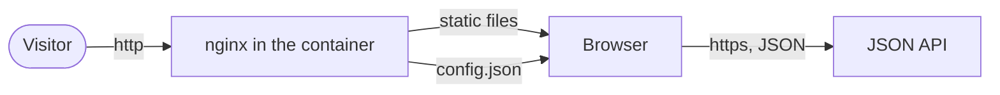
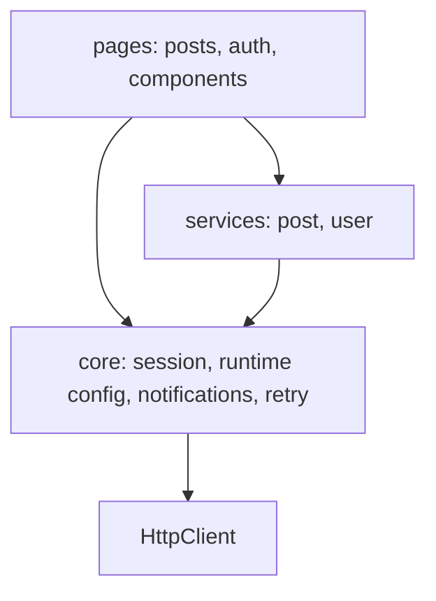
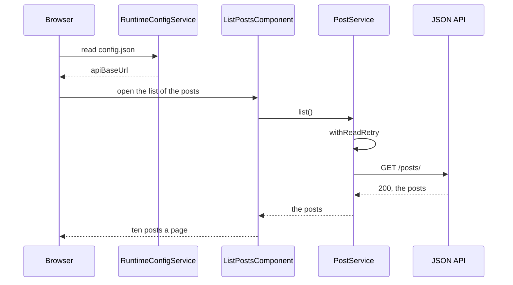
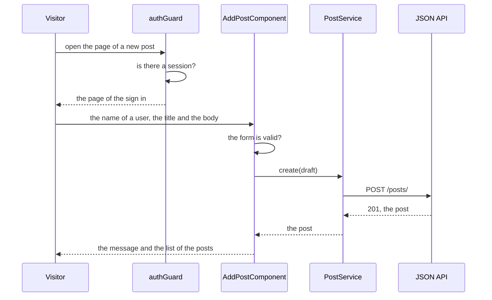
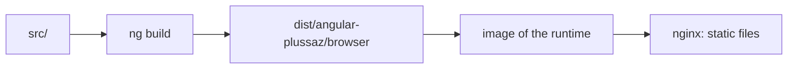

# The architecture of Angular PlussAz

The application is a single page application. The browser loads the files of
the build once, and every page of the application is drawn from those files.
The data comes from a JSON API that the application does not own.

## The shape of the system

The web server does two things: it delivers the files of the build, and it
writes the file `config.json` next to them. The address of the API is read
from that file when the application starts, so one image serves every
environment.

The API of the demonstration is the public mock
[JSONPlaceholder](https://jsonplaceholder.typicode.com). The application holds
no data of its own.

## The layers of the code

| Folder               | Holds                                                                                                                    | Knows about                      |
| -------------------- | ------------------------------------------------------------------------------------------------------------------------ | -------------------------------- |
| `src/app/core`       | the session, the runtime configuration, the messages, the repetition of a read, the guard                                | nothing above it                 |
| `src/app/posts`      | the model of a post, the service of the posts and of the users, the pages of the list, of the creation and of the change | `core`                           |
| `src/app/auth`       | the page of the sign in                                                                                                  | `core`, the service of the users |
| `src/app/components` | the head, the foot and the pages of the pagination                                                                       | `core`                           |

The rule of the folders: a folder never reaches into a folder beside it. The
pages of the posts ask the service of the posts, the service asks the core,
and the core asks nothing but the browser. A dependency that points the other
way is a defect, and the tests of the services hold that line.

## The parts of the core

| Part                   | Responsibility                                                                      |
| ---------------------- | ----------------------------------------------------------------------------------- |
| `RuntimeConfigService` | reads `config.json` before the first page is drawn and holds the address of the API |
| `SessionService`       | holds the user of the session in a signal and in the storage of the browser         |
| `NotificationService`  | holds the message of the last action in signals                                     |
| `withReadRetry`        | repeats a read when the API cannot be reached or answers with a server error        |
| `describeApiError`     | turns the answer of the API into a sentence for the user                            |
| `authGuard`            | sends a visitor that has not signed in to the page of the sign in                   |
| `API_BASE_URL`         | the token that carries the address of the API into the services                     |

## The state of the interface

The application runs without zones. The state that the interface shows lives
in signals, and the change detection reads the signals through `computed` and
`effect`. The rule is simple: a value that the interface shows is a signal, a
value that is derived from other signals is a `computed`, and a side effect
that has to happen once belongs to an `effect`.

The message of a successful action and the reason of a failure disappear after
five seconds. The timer is set in an `effect` of the root component and is
cancelled when a new message arrives, so a message never disappears earlier
than its own five seconds.

## The way a request leaves the application

The service reads the address of the API from the token `API_BASE_URL` and
builds the address of every call from it. The repetition of a read sits
between the page and the service, so a page never repeats a call itself.

## The way a write reaches the API

A write is never repeated. The repetition of a request is only for the reads,
because a second attempt of a write would create a second post.

## The build

The build produces a directory of static files. The image of the runtime
copies that directory into the web server, and the web server answers every
address that is not a file of the build with the page of the application. The
router of the browser takes the address from there.

The pieces of the build are in `build/app/Dockerfile` (the images), in
`build/nginx/` (the web server) and in `angular.json` (the builder of the
command line).

## The decisions

The reasons for the shape of the code are in [decisions/](decisions/).
