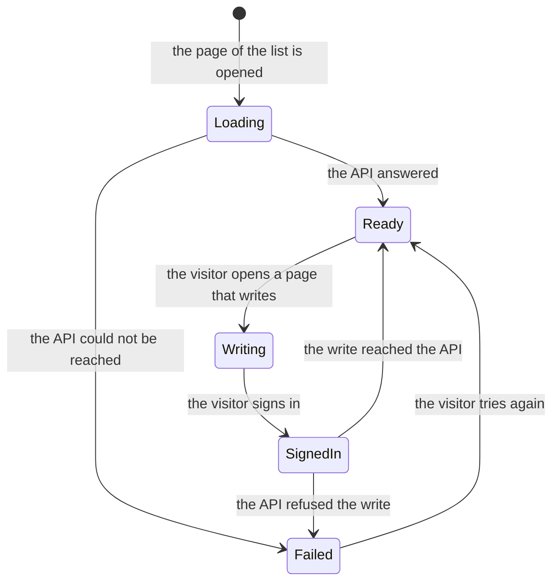

# The business logic of Angular PlussAz

The application is a front end for a blog API. It shows the posts of the API,
opens one of them, creates a post, changes a post and removes a post.

## Who uses it

The visitor of the demonstration. There is no other kind of user: the API is
public, it has no accounts, and it answers every caller. The sign in of the
application is a convenience of the interface, not a security boundary. See
[security.md](security.md).

## The use cases

| Use case                  | Who starts it       | What happens                                                            | What the visitor gets                        |
| ------------------------- | ------------------- | ----------------------------------------------------------------------- | -------------------------------------------- |
| See the list of the posts | anyone              | the application asks the API for the posts and shows ten of them a page | the list, with a page control                |
| Open a post               | anyone              | the API is asked for one post                                           | the title and the body of the post           |
| Create a post             | a signed in visitor | the title and the body are sent to the API                              | a message, and the list of the posts         |
| Change a post             | a signed in visitor | the post is loaded, the fields are changed and sent back                | a message, and the list of the posts         |
| Remove a post             | a signed in visitor | the API is asked to remove the post                                     | a message, and the list without the post     |
| Sign in                   | anyone              | the name of a user is looked up in the list of the users of the API     | a message, and the pages that write are open |

## The entities

| Entity  | Where it lives             | The fields the application uses   |
| ------- | -------------------------- | --------------------------------- |
| Post    | the API                    | `id`, `userId`, `title`, `body`   |
| User    | the API                    | `id`, `name`, `username`, `email` |
| Session | the storage of the browser | `id`, `name`, `username`, `email` |

The application keeps no copy of the posts: every change is sent to the API
and the answer of the API is what the interface shows. The one thing the
browser keeps is the session, under the key `angular-plussaz.session.v1`.

## The rules

### The list of the posts

- A page holds ten posts.
- The list shows the posts of the API in the order the API gave them.
- The pages are numbered from one, and the number of the pages follows from
  the number of the posts and the size of a page.
- A page that is already on the screen is not drawn again, and a page outside
  the range is refused.

### The writing of a post

- A post has a title and a body, and both are needed.
- The title holds at most 200 characters, the body at most 500.
- A form that does not pass these rules is not sent to the API, and the
  fields that failed are marked.
- The user of the post and the number of the post are set by the API, not by
  the visitor.

### The removal of a post

- The post leaves the list at once when the API confirms the removal.
- A removal that the API refuses leaves the list as it was, and the reason is
  shown.

### The session

- A visitor that has not signed in is sent to the page of the sign in when he
  asks for a page that writes.
- The sign in asks for the name of a user of the API. The API holds no
  accounts, so the name is enough: the application looks the name up in the
  list of the users and keeps what it finds.
- A name that the API does not know is refused with a message, and no session
  is started.
- The page the visitor wanted to see is kept in the address of the sign in and
  is opened again after the sign in. Only a path of this application is
  accepted, so the address cannot send the visitor to another host.
- The sign out removes the session from the storage of the browser and sends
  the visitor to the list.

### The messages

- A successful action and a failed action never stand next to each other: the
  new message replaces the other one.
- A message stays on the screen for five seconds and then disappears.
- The reason of a failure is a sentence for the user, never the raw answer of
  the API.

### The reading of the API

- A read is repeated twice when the API cannot be reached or answers with a
  server error, and the pause between two attempts is 250 milliseconds.
- A read is not repeated when the API answers that the resource is not there:
  that answer is final.
- A write is never repeated.

## The states of a page of the application

The pages that write have two more states of their own: `submitting`, while
the API is busy, and the state of a form that does not pass the rules. Both
are held in a signal of the page, so a second click cannot send a second
write while the first one is in flight.

## The error cases and what the visitor sees

| Case                                             | What the visitor sees                                                         |
| ------------------------------------------------ | ----------------------------------------------------------------------------- |
| The API cannot be reached                        | "The API could not be reached. Check the network and the address of the API." |
| The API answers that the post is not there       | the message of the API, or "The API answered with the status 404."            |
| The API answers with a server error, three times | the message of the API, or the sentence of the status                         |
| The form is not valid                            | the fields that failed are marked, and nothing is sent                        |
| The address of the post holds no number          | the visitor is sent to the list, with the reason shown                        |
| The name of the sign in is unknown               | "The API knows no user called ..." and no session is started                  |

## The limits

- The application has no database. Everything it shows comes from the API.
- The session holds no secret, because the API needs none. A real deployment
  would keep a token of the API here and the API would check it.
- The address of the API is the only thing a deployment can change. The rest
  of the behaviour is in the build.
- The list holds every post of the API in the memory of the browser. An API
  with a large number of posts would need a paged answer from the API, and the
  paging would move from the browser to the API.
