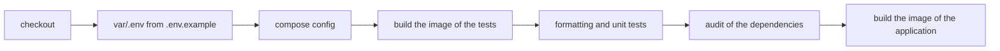

# The tests of Angular PlussAz

Every test runs inside a container of the project. The host needs Docker and
nothing else: no Node, no browser, no tool of the command line.

## The runner

The runner is vitest, driven by the builder of the command line of Angular
(`@angular/build:unit-test`). The tests live beside the code they hold, in
the file `<name>.spec.ts`, and they use the globals of vitest. The types of
those globals are in `tsconfig.spec.json`.

The suite has 15 files and 57 cases. It holds the parts of the application
where a mistake is expensive and cheap to catch:

| Part                         | What the tests hold                                                                                                    |
| ---------------------------- | ---------------------------------------------------------------------------------------------------------------------- |
| the services of the posts    | the method, the address and the body of every call, the repetition of a read, the absence of the repetition of a write |
| the service of the users     | the call of the list of the users                                                                                      |
| the errors of the API        | the sentence of every shape of an answer                                                                               |
| the configuration of the run | the reading of `config.json`, the fall back to the compiled address, the broken file                                   |
| the session                  | the sign in, the sign out, the broken entry of the storage                                                             |
| the guard                    | the pages that write are closed for a visitor that has not signed in                                                   |
| the messages                 | the message of a success and the message of a failure never stand next to each other                                   |
| the pages                    | the list, the creation, the change and the sign in                                                                     |

## The commands

The whole gate of the project, inside the container of the tests:

```shell
mkdir -p var
cp .env.example var/.env
docker compose --env-file var/.env --profile test run --rm test
```

That command runs the check of the formatting and then the unit tests. The
image of the tests needs neither a database nor a service of the stack, and
it reads no environment file, so the values of the local machine cannot
change the result.

The other steps of the gate:

```shell
# the compose file is valid
docker compose --env-file var/.env config --quiet

# the audit of the dependencies
docker compose --env-file var/.env --profile test run --rm --entrypoint npm test audit --audit-level=high

# the image of the application is built
docker compose --env-file var/.env build app
```

## The check of the formatting

Prettier holds the shape of the files. The rules are in `.prettierrc`: a line
of 100 characters, single quotes and the parser of Angular for the templates
of the components. The files that are not written by hand are in
`.prettierignore`: the build, the dependencies, the reports of the tools, the
lock file and the diagram of the drawing tool.

The check runs before the tests, so a file that breaks the rules never reaches
the suite.

## The gate of the pipeline

The pipeline of the repository runs the same steps in the same order:



The pipeline holds the branch `master` and the branch `test`: a pull request
into either of them runs the whole gate before it can be merged.

## What is not tested, and why

- **The browser end to end.** The suite holds the behaviour of the
  components with the test bed of Angular, not the click of a real browser.
  A test of the browser would need a browser image and a server, which the
  project does not have yet.
- **The web server.** The configuration of nginx is checked by the image
  itself: the container answers `/healthz` and delivers the files of the
  build. The rules of the web server are in
  [deployment.md](deployment.md).
- **The API of the demonstration.** The mock of the internet is not part of
  the gate, because the gate has to give the same answer on a machine without
  a network. The calls of the services are held with the test backend of
  `HttpClient`.

## How a test is written

- The name of a case says what the behaviour is, not what the code does: "a
  read is repeated when the API answers with a server error" and not "calls
  the function twice".
- A case holds one behaviour. When a case needs two, it is two cases.
- The state is set up in `beforeEach` and checked in the case, so a case does
  not lean on the case before it.
- A test that cannot fail is a test that costs time and says nothing. Every
  case of the suite fails when the behaviour it holds is broken; the suite was
  checked against a broken implementation while it was written.
